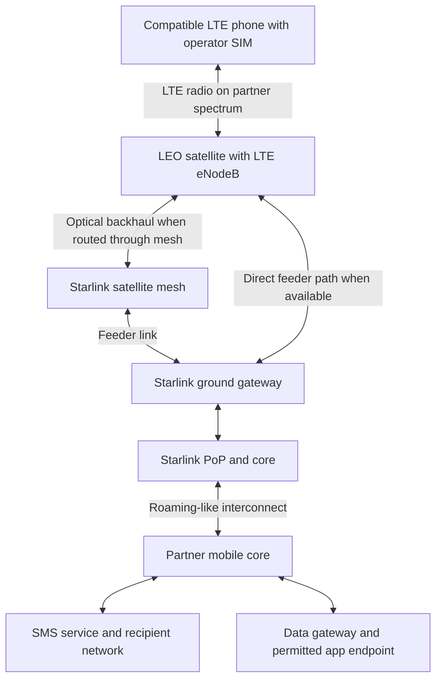
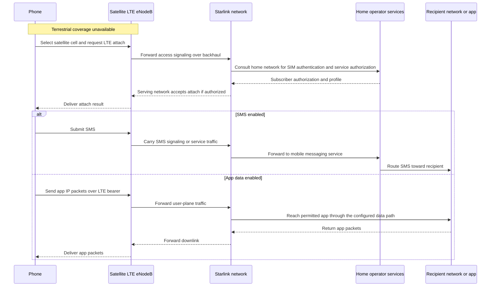

**Starlink Direct to Cell (D2C)** gives an eligible LTE phone a second way to reach its mobile operator when terrestrial coverage is unavailable. The phone talks LTE directly to a base station on a low-Earth-orbit (LEO) satellite, using cellular spectrum made available through an operator partnership. Starlink carries the traffic to the ground and interconnects with the operator. The customer uses a compatible phone and their mobile subscription, with no external antenna. [SpaceX technical overview][1]

## What happened in Kazakhstan

- **September 2025** — Beeline Kazakhstan signed a commercial agreement, according to VEON’s 6 November announcement. The November announcement also covered a ministry memorandum and VEON’s separate, non-exclusive global framework agreement with Starlink. Each market still has its own rollout and approvals. [VEON partnership announcement][2]
- **December 2025** — A field trial in Akmola region exchanged SMS and WhatsApp messages and completed a WhatsApp audio call on a standard 4G phone with a Beeline SIM. The call used app data. [VEON field trial][3]
- **29 September 2026** — VEON reported commercial launch with messaging and basic app connectivity in terrestrial dead zones. Beeline’s launch instructions specified compatible Android devices, activation in Janymda, and data roaming enabled. The satellite network can appear as **Beeline Starlink** or **401 04**. Device support and plan terms can evolve. [VEON launch][4] · [Beeline launch and setup][5] · [Beeline service page][6]

## From the phone to the mobile core

1. **Access.** When the phone loses terrestrial coverage, normal network selection can find the satellite LTE cell if the network is detectable and the SIM and device are eligible. The phone transmits on a supported LTE band. The onboard **eNodeB** terminates the LTE radio link. Large phased-array antennas and satellite-side processing help close the link budget and handle the timing and Doppler effects of a fast-moving satellite.
2. **Transport.** Starlink moves traffic over its space and ground network. Optical links can relay traffic to a satellite with a path to a ground gateway. A Starlink point of presence (PoP) and core then connect to the mobile operator. The phone’s LTE radio hop and the satellite’s feeder/backhaul hops serve different purposes.
3. **Service delivery.** The roaming-like integration lets the operator authorize subscribers and deliver the services enabled for their plan. For SMS, mobile messaging infrastructure routes the message onward to the recipient. For app data, the device sends IP packets over an LTE bearer to an eligible service via a packet gateway. Return traffic follows the corresponding downlink. An app voice call uses the data path. Native dialer calling requires separate support for operator voice, such as IMS/VoLTE. [SpaceX technical overview][1] · [VEON launch][4]

## Attach, SMS and app data

**Diagram scope.** Both figures are logical views. The first shows an operator-core data path consistent with Starlink’s published overview. The second leaves the IP anchor implicit. In LTE roaming, home-routed traffic can traverse GTP-U to a home packet gateway, while local breakout exits through a serving-network gateway. Beeline’s public materials do not specify its gateway placement, interconnect interfaces, IP breakout location, or SMS transport. Use [[GTP Proxy]] for related mobile-core context. [SpaceX technical overview][1] · [3GPP TS 23.401 LTE architecture][7]

## Why mobile operators want it

Here **MSP** means mobile service provider, primarily a mobile network operator (MNO) such as Beeline. The following are business implications of the partnership model.

| Operator objective | What D2C changes |
| --- | --- |
| Extend reach into sparse areas | Add a layer of outdoor coverage across roads, steppe and remote worksites where individual towers are expensive to power, connect and maintain relative to demand. |
| Differentiate and retain customers | Offer off-grid reach on an existing mobile subscription. The operator can bundle it into premium or enterprise plans or sell it as an add-on. |
| Add a path during local outages | Handsets may still reach the satellite network when local cell sites or backhaul fail, provided the satellite network, interconnect and required core services remain reachable. |
| Serve enterprises with mobile crews | Provision eligible lines and package connectivity with check-in, dispatch or asset-tracking workflows. The operator relationship covers activation, billing and support. |
| Expand across markets | A group can reuse commercial and integration work across affiliates. Each country still needs local spectrum and regulatory arrangements, compatible devices and a product launch. |

Starlink provides the satellite access and backhaul. The MNO contributes spectrum access, subscribers, mobile service integration and distribution. A commercial evaluation compares wholesale fees and core integration costs with the value of added coverage and the cost of terrestrial expansion. The VEON announcements do not disclose Beeline’s wholesale pricing. [SpaceX technical overview][1] · [VEON partnership announcement][2]

## Use cases

| Scenario | Useful traffic | What determines feasibility |
| --- | --- | --- |
| Highway breakdown or outdoor travel | SMS to family or dispatch with location and status | Eligible line and device, clear sky and successful delivery |
| Utilities, mining and field maintenance | Crew check-in, job status, coordinates or a short dispatch message | Test the actual route, handset and approved app |
| Disaster response and local cell outages | Short welfare and coordination messages | Check shared core dependencies and congestion during peak demand |
| Public safety | Request help and share position through an available channel | Verify emergency-number routing, location handling and availability with the operator for the specific device and service |
| Fleet and remote sensors | Small position reports, alarms and periodic telemetry | Confirm module, LTE band, subscription, reporting interval and power budget. Beeline handset availability does not establish an IoT offer |
| Low-bandwidth consumer apps | Text chat or limited app features. App audio where supported | Permitted apps and features vary by market, device and plan |

## What sets the limits

- **Reach and capacity are different.** A wide footprint can deliver essential messages to scattered users. Shared spectrum, beam capacity and the small handset link budget constrain sustained throughput and simultaneous use. Fixed-site broadband and cell-site backhaul generally call for a dedicated terminal.
- **Conditions matter.** Buildings, terrain and foliage can block the radio path. Satellite and terrestrial reselection can interrupt sessions. Evaluate delivery time and success in the actual locations where the workflow matters.
- **Provisioning matters.** Coverage depends on authorized geography, spectrum, handset support, service activation and network selection. Test SMS in both directions, application behavior after connection loss and the return to terrestrial coverage.
- **Voice, messaging and IP are separate capabilities.** Native calls, emergency services, SMS, app chat and general Internet access each need explicit verification for the local product. The Beeline field trial establishes WhatsApp audio in that test. [Beeline setup][5] · [VEON field trial][3]

[1]: https://starlink.com/public-files/DIRECT_TO_CELL_FIRST_TEXT_UPDATE.pdf

[2]: https://www.veon.com/newsroom/press-releases/veons-beeline-kazakhstan-partners-with-starlink-direct-to-cell-to-launch-satellite-connectivity-to-kazakhstan-with-support-from-kazakhstan-ministry-of-artificial-intelligence-and-digital-development

[3]: https://www.veon.com/newsroom/press-releases/veons-beeline-kazakhstan-delivers-first-starlink-direct-to-cell-call-in-central-asia

[4]: https://www.veon.com/newsroom/press-releases/veons-beeline-kazakhstan-becomes-first-operator-in-country-to-launch-starlinks-satellite-to-mobile-service

[5]: https://beeline.kz/ru/events/news/280926

[6]: https://beeline.kz/ru/starlink

[7]: https://www.3gpp.org/dynareport/23401.htm
